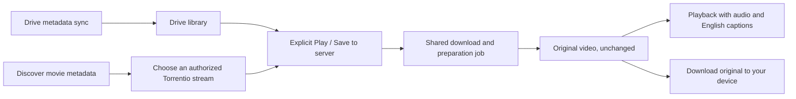

# DriveTheater

> A self-hosted, play-first media library for Google Drive and authorized sources.

Independent project: [HummaX/DriveTheater](https://github.com/HummaX/DriveTheater). This is **not an upgrade of DriveConnector** and does not reuse its credentials or storage.

**Release status:** published preview. Local tests and synthetic browser checks pass; a real Ubuntu 24.04/Docker installation and live external providers remain unverified. The bootstrap below pins the published source revision [`42d2f9f`](https://github.com/HummaX/DriveTheater/commit/42d2f9f9e1fcc7397957ce7d9482f0ce3e191742), not a mutable branch.



## How it works

| Screen | What you can do |
|---|---|
| **Drive library** | Browse all synced titles without downloading them. Movies and series share one grid. A **Series** card opens its seasons and episodes. Search, status filters and Continue watching help find your place. |
| **Discover** | Browse/search an IMDb-ID-based movie catalog, then select an authorized stream from your configured Torrentio-compatible add-on. Metadata comes from Cinemeta by default, or your configured compatible catalog. This is not an IMDb service. |
| **Sources** | Connect Google Drive using public links, an API key, a service account, or OAuth. Sync retrieves metadata, not full videos. Advanced compatible-stream and series lookup is also available. |
| **Downloads** | Follow real download/package/preview/caption progress. Cancel or retry jobs. Simultaneous requests share one active job per title. |
| **Server** | Inspect runtime CPU/RAM, disk, DB, network, worker status, downloader availability, alerts, and local activity. Clear your local history. |
| **Settings** | Control cache cleanup, free-space headroom, download/preparation concurrency, schedules, ingest bandwidth, activity retention, and password. |

The dark blue/violet interface uses system fonts, responsive cards, native keyboard-focusable movie dialogs, and **selective tooltips delayed by 500 ms**. Live server events update the UI automatically, with polling as a fallback.

### Original quality, not quality conversion

- No video-quality menu, thumbnail quality badges, or multi-quality ladder.
- The original compressed video is **stream-copied**, not resized or re-encoded, during supported HLS packaging.
- H.264 is packaged as MPEG-TS; HEVC/AV1/VP9 use fragmented MP4. Browser codec support varies. Unsupported formats fail clearly rather than starting a heavy video conversion.
- Audio preparation can still convert tracks to AAC. Small previews, thumbnails, subtitles and optional local captions also use CPU; this is not a zero-processing promise.
- Audio choices follow English/Hindi/explicit-original metadata; a fallback may be available when preferred tracks are absent. The app never guesses a film's original language.
- Captions are English only, with extraction, SRT/VTT upload, search and timing offsets. Optional local automatic captions run after media becomes playable; the model/dependency path is not live-verified.

### Save to server versus download to device

**Save to server** creates/reuses a cache job. It follows the configured ingest schedule and bandwidth limit; explicit **Play** bypasses the schedule.

**Download to device** appears once the complete original file is cached. It serves an authenticated attachment directly from this server, supports HTTP byte ranges and validator-safe resume, and protects active transfers from cleanup. It never starts another provider download or fetches a full file into a JavaScript blob. Device transfers are not subject to the ingest bandwidth limit; actual speed depends on server upload, client connection and disk.

There are no profiles or content pins. Only use media you are authorized to access; no DRM or access-control bypass is provided.

## Ubuntu 24.04 installation

The installer uses the existing root disk, with source in `/opt/drivetheater`, data in `/var/lib/drivetheater`, and private configuration in `/etc/drivetheater/install.env`. No manual dotenv editing, extra disk mount or formatting is required. It generates new admin credentials and secrets for each fresh server.

**Pinned preview bootstrap for a fresh Ubuntu 24.04 host.** Review the script and remaining release boundaries first; running it installs the runtime dependencies. It has not been production-tested on a real host here.

```bash
curl --proto '=https' --tlsv1.2 -fsSL https://raw.githubusercontent.com/HummaX/DriveTheater/42d2f9f9e1fcc7397957ce7d9482f0ce3e191742/scripts/install.sh | sudo bash -s -- --version 42d2f9f9e1fcc7397957ce7d9482f0ce3e191742
```

The default worker CPU quota is approximately 90% of detected CPU (about **14.4 vCPUs on a 16-vCore host**). It bounds the worker, not the whole host, and does not guarantee 10% of host CPU always remains idle. Start with one preparation job. Hardware acceleration is intentionally excluded.

Use HTTPS or a trusted VPN for remote login. Direct public HTTP is not an encrypted production login path. Read [installation and recovery](docs/installation.md) before deploying.

## Monthly server replacement

Export a **private setup bundle** containing Drive connections, add-on configuration and settings, but no cached media, users, sessions or watch history. Treat it as a credential-bearing secret; never upload it to the public repository.

```bash
sudo bash /opt/drivetheater/scripts/manage.sh export-setup /root/drivetheater-private-setup.json
```

Copy that private file securely to the new server and pass `--setup-bundle /absolute/path/to/private.json` to the version-pinned installer. The new installation keeps newly generated admin credentials/secrets; cached media is fetched again only on explicit requests. See [operations](docs/operations.md).

## Operations

```bash
sudo bash /opt/drivetheater/scripts/manage.sh status
```

```bash
sudo bash /opt/drivetheater/scripts/manage.sh login
```

```bash
sudo bash /opt/drivetheater/scripts/manage.sh doctor
```

```bash
sudo bash /opt/drivetheater/scripts/manage.sh backup
```

```bash
sudo bash /opt/drivetheater/scripts/manage.sh update REVIEWED_COMMIT
```

Updates back up persistent state, build before replacing the running image, and attempt to restore the previous app image on failure. They **never automatically roll back the database**. Rehearse real install/update/restore on a disposable Ubuntu host before production use.

## Verification and development

- Core suite: **63 tests, 2 skipped** (Windows symlink privileges unavailable).
- API suite: **20 passing**; includes authenticated/resumable device downloads and mocked discovery without queueing media.
- Frontend: **22 passing**, TypeScript and Vite production build pass.
- Synthetic FFmpeg tests verify alternate audio, previews, and identical decoded video frames after stream-copy packaging.
- Browser checks cover desktop/375px phone layouts, series navigation, delayed selective tooltips, device Range responses, and English/Hindi switching without losing paused position.
- Real Google/provider/torrent/model execution and Ubuntu/Docker deployment are **not** established by these tests. The frontend build retains a large-bundle warning; this is not a performance certification.

Runtime requires Python 3.10+ (container: 3.12), FFmpeg/ffprobe, and `backend/requirements.txt`. Frontend build uses Node 24 and `frontend/package-lock.json`. Do not execute optional external downloader/transcription dependencies without reviewing them and authorizing their use.

Read the [user guide](docs/user-guide.md), [architecture](docs/architecture.md), [UI design notes](docs/ui-design.md), [source support](docs/sources.md), and [release verification](docs/release-review.md).

## License

MIT. Independently implemented for HummaX; DriveConnector is not a runtime dependency.
