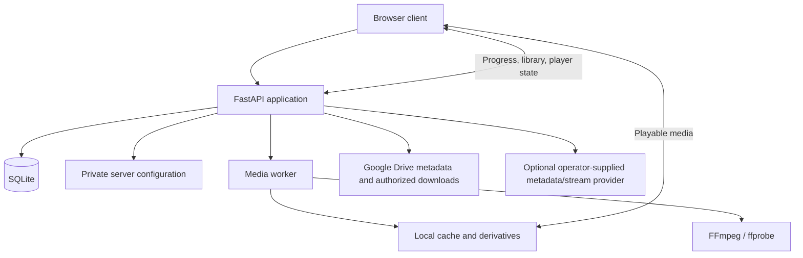
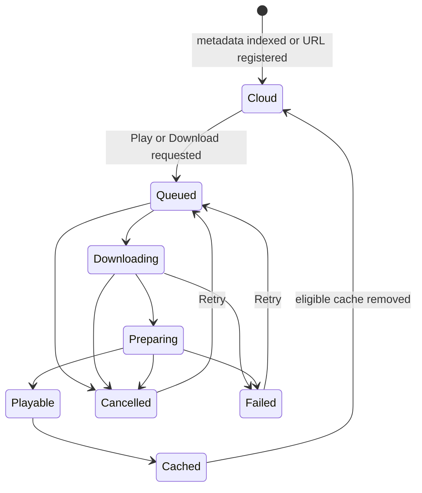

# Architecture

## System shape

DriveTheater is a local, self-hosted application with a browser client, an API, SQLite-backed state, and a separate media worker. The public interface is play-first: source synchronization records metadata, while a later Play or Download request creates the media work.

## Data and trust boundaries

| Boundary | Responsibility | Important constraint |
|---|---|---|
| Browser | Library, source, download, server, settings, and player views | It receives only the server API results and media delivery paths it is allowed to use. |
| API | Authentication, source records, jobs, library state, settings, and health/status endpoints | Secrets are stored on the server and are not returned to the browser. |
| SQLite | Users, library metadata, work state, settings, history/activity | Database data is persistent under the configured data directory. |
| Worker | Download, validation, FFmpeg inspection/preparation, cache lifecycle | CPU-based processing is bounded by worker settings; no hardware acceleration is included. |
| Cache | Requested media and derived assets such as suitable previews/subtitles | Cache is disposable relative to the library record; it is excluded from backups. |
| External services | Google Drive and optional operator-supplied provider endpoints | Credentials, availability, rate limits, returned metadata, and access policy remain external. |

## Playback lifecycle

The UI reports only what the job can currently measure. Byte transfer may have a numerical bar; other preparation phases can remain indeterminate. Multiple requests for the same title are intended to share durable work rather than independently fetch it.

## Media strategy

1. A source record supplies metadata for a Drive folder or an explicitly registered authorized URL.
2. The worker evaluates the source and creates cache work only after a user requests Play or Download.
3. Suitable fast-start H.264/yuv420p MP4 media with zero or one supported audio track can be eligible for progressive delivery while bytes become available.
4. Other supported media is prepared into HLS as processing progresses. Multi-audio results can have separately labelled audio renditions.
5. Eligible text subtitle extraction can expose a text track. Image subtitles that cannot become text tracks are not claimed as usable captions.

HLS contains one original-video stream, copied without video encoding, resizing or bitrate conversion. H.264 uses MPEG-TS; HEVC/AV1/VP9 use fragmented MP4 and still require browser codec support. There are no quality badges, quality selector or adaptive ladder. Audio can be converted to AAC; small preview assets are separately derived. Unsupported source codecs fail without falling back to video encoding.

Completed original files also have an authenticated attachment endpoint with Range/If-Range, ETag and Last-Modified support. Transfers stream bounded chunks, renew an active-cache lease and do not use the ingest bandwidth throttle. Partial files return a not-ready response rather than advertising missing bytes.

## External integration contracts

### Google Drive

- Inputs: selected folder identifier/link, authorization mode, and only credentials supplied by the operator.
- Outputs: metadata, thumbnails where available, and authorized media responses.
- Failure contract: access denial, quota/rate limits, expiry, and unsupported folder structures are surfaced as errors; they are not converted into a false ready state.

### Optional compatible-stream and metadata provider

- Inputs: an operator-supplied manifest URL plus media type/IMDb identifier; series metadata may use a separately supplied metadata manifest.
- Outputs: candidate stream metadata and optional episode list.
- Boundary: lookup and library registration do not claim a download or playback. The provider is optional, external, and unverified by this repository's documentation.

## Operations and recovery

The installer keeps source under `/opt/drivetheater`, durable runtime data under `/var/lib/drivetheater`, and private installation settings under `/etc/drivetheater/install.env` by default. The web port alone is published; worker and database ports are not.

Backups use SQLite-aware handling and record configuration/manifest data, but exclude cached videos and derivatives. An update takes a backup before source changes and has no automatic database rollback. Operators must preserve failed state, validate schema compatibility, and restore deliberately with no open writers. See [installation and recovery](installation.md).

- The separate Discover workspace uses an IMDb-ID-based metadata catalog and operator-supplied stream manifest. Private add-on URLs are stored in settings and exported only in the secret setup bundle; status endpoints return booleans, never configured URLs.
- Opening a movie fetches stream metadata only. Selecting Play/Download explicitly registers a source and queues its shared job. Opening a Series library card only reveals local season/episode metadata.
- The authenticated UI uses one SSE connection for invalidation and retains polling fallback. Reconnecting state is visible.

## Explicit non-goals and verification boundaries

- No profiles, content pins, quality conversion or hardware acceleration.
- Audio policy filters English/Hindi/explicit original labels, with fallback where needed. It cannot invent missing language tracks or infer a film's original language.
- Subtitle search/offsets, TV controls, local history clearing and live reconnect state are implemented. The Docker media quota targets approximately 90% of detected CPU; this is not a guarantee of 10% idle host capacity.
- Bookmarks, picture-in-picture, casting and offline queues are not implemented.
- Live provider/transcription dependencies, browser support for every codec, and real Ubuntu/Docker install/update/restore remain unverified. See [release verification](release-review.md).
